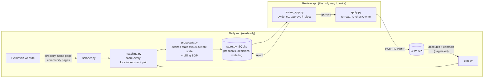
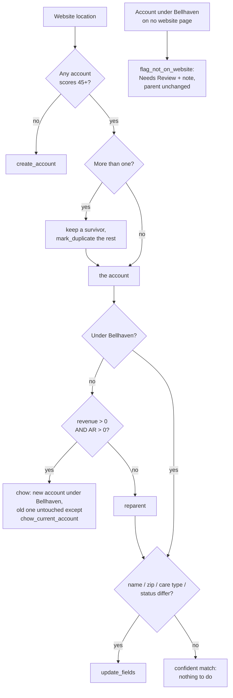
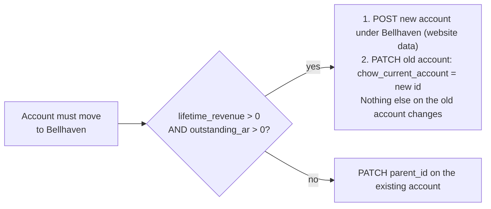
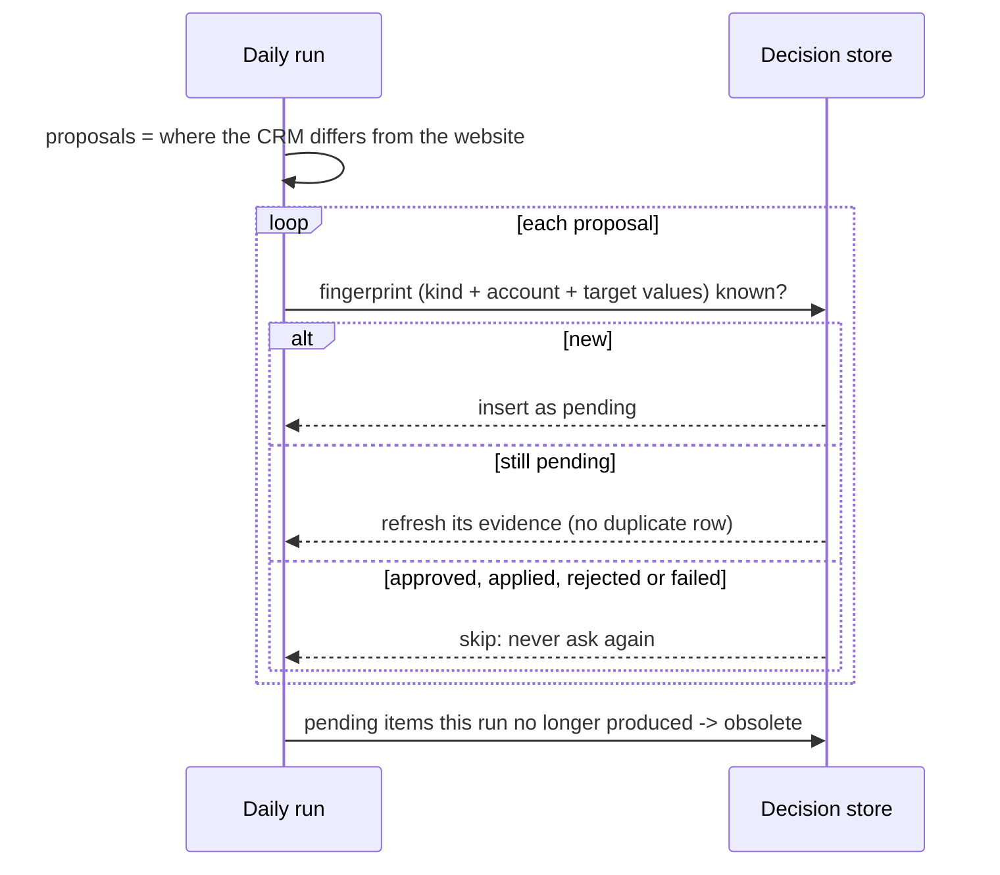

# bellhaven-sync

Keeps the CRM's facility-to-parent links in sync with an operator's website. Every day it scrapes Bellhaven
Senior Living's community pages, matches each location to its CRM account(s), and queues the changes it
believes are needed. A person approves or rejects each change in a small review app. **Nothing is written
to the CRM without approval.**

```
python -m bellhaven_sync run      # scrape + match + queue proposals (read-only against the CRM)
python -m bellhaven_sync serve    # review app at http://127.0.0.1:5000
```

## What the first run found

| | |
|---|---|
| Website locations | **35**: 34 in the directory, plus *Bellhaven Meadows of Findlay*, which is only linked from the home page ("New this year"). The home page says "35 communities", so the scraper checks its count against that. |
| CRM accounts | 121 accounts and 67 contacts |
| Confident matches, nothing to change | 13 |
| Matches that need a fix | 18 (wrong parent, rebranded name, zip typo, duplicates) |
| No CRM account yet | 4: Batavia, Carlisle, Amberly Manor (Hudson OH), Bellhaven at Union Square |
| Under Bellhaven but on no website page | 3: Alliance, Coldwater, Sandusky |

Those turned into **30 proposals**: 2 changes of ownership under the billing SOP (Tiffin, Marietta), 4 re-parents
(Lima, Findlay, Zanesville, Kettering), 7 duplicate copies (Owosso, Port Clinton, Erie, Monroe ×2, Kettering ×2),
4 new accounts, 10 field fixes (6 names after rebrands or spelling variants, 1 zip typo, ...), and 3 "not on website"
flags. A second run proposes nothing new.

## Architecture



| Module | Job |
|---|---|
| `scraper.py` | Follows the directory's "Next" links (never page numbers: the site returns the last page again for out-of-range numbers), adds community links from the home page, then reads every community page, the only place with the full address. A location missing a required field fails the run instead of producing half-empty proposals. |
| `crm.py` | API client. Paginates, retries GET/PATCH on 429/5xx, and never retries POST (a retried create could make a second account). |
| `normalize.py` | Makes spellings comparable: `Rd`/`Road`, `W`/`West`, `NW`/`Northwest`, `Pk`/`Pike`, phone digits, zip5, `&`/`and`, `Centre`/`Center`. |
| `matching.py` | Scores every pair, accepts at 45+, groups duplicates and picks a survivor, finds Bellhaven accounts no page lists. |
| `proposals.py` | Turns findings into concrete changes with their evidence. Applies the billing SOP. |
| `store.py` | Queue, decisions, run history, and an audit log of every CRM write. Fingerprints make re-runs safe. |
| `apply.py` | The only code that writes. Re-reads the account first and stops if anything changed. |
| `review_app.py` | Flask app: queue, evidence, approve/reject, decided items, all locations, write log, "run now". |

## Matching

Matching is evidence scoring, not name matching. Each website location is scored against every CRM account
(35 × 121 pairs is small enough to skip blocking):

| Signal | Points | Why it's weighted this way |
|---|---|---|
| Street address + city + zip (normalized) | 50 | The strongest identity signal. Street + city with a different zip scores 40 and proposes a zip fix. |
| The website's administrator is a contact on the account | 25 | Survives rebrands and bad addresses. Matches Ashtabula, whose CRM billing address is a PO box. |
| Phone | 20 | Strong when equal, but many CRM phones are stale, so a mismatch costs nothing. |
| Name similarity (brand word removed) | 15 / 8 | Weak on purpose: rebrands change names, and lookalike names lie. |
| Contacts with an @bellhavenliving.com email | 5 | Evidence of ownership. |
| Same city and state / compatible care type | 5 each | Tie-breakers. |
| **Different state** | disqualified | Keeps "Amberly Manor, Hudson OH" away from the "Amberly Manor" in Colorado. |

- **Accept at 45**, which in practice means "the address matches" or "two other strong signals agree". 70+ is shown as high confidence.
- **One account, one location:** an account that qualifies for two locations goes to the better-scoring one.
- **Duplicates:** when several accounts are accepted for one location, they are copies of one facility. The survivor is chosen deterministically, so re-runs agree: already under Bellhaven > has billing history > has more contacts > higher score > lowest account id.
- **Excluded from matching:** parent-company accounts, accounts already marked `duplicate_of_account`, and old accounts kept for billing after a change of ownership (`chow_current_account` set). This is why a resolved case never comes back.



## The billing SOP

Checked twice: when the proposal is built, and again on fresh CRM data at the moment it's approved.



- **Tiffin** ($84,000 revenue, $12,400 AR) and **Marietta** ($51,250, $3,800) take the change-of-ownership path.
- **Lima** has $47,000 of revenue but $0 AR, and **Findlay** has $22,000 and $0 AR, so both are re-parented directly. "AND" means both conditions must be true.
- If AR is paid off between the run and the approval, the approval stops ("the SOP branch is different now") and the next run proposes the right thing.

## Safe re-runs



- **Approved changes** don't come back because the CRM now matches the website, so there's nothing to propose. This is desired state minus current state.
- **Rejected changes** don't come back because their fingerprint is remembered.
- **Pending proposals that no longer apply** become *obsolete*: someone fixed the data by hand, so nobody should approve the stale change.
- **Writes are guarded**:
  - `apply.py` compares the account with the values the proposal was based on and refuses to write if they changed.
  - A created account's id is saved immediately, and a retry reuses it instead of creating a second account.
  - Every write is logged with its request and response.

## Judgment calls

- **Accounts under Bellhaven that no page lists go to Needs Review, not Inactive or a new parent.** The website can't tell us whether a facility was sold or closed. Sandusky also has revenue and AR, so guessing a new parent would break the SOP. The note says what to check.
- **Ashtabula's PO box stays.** It's a *billing* address, and PO boxes are normal for billing. The match comes from the administrator and phone instead.
- **Phones aren't overwritten.** Many CRM phones differ from the website, which could be a front desk vs a billing line. The difference is shown as evidence, and phone updates are listed under next steps.
- **Names are aligned to the website**, the operator's current name. Rebrands (Riverbend Manor → Bellhaven of Chagrin Falls) and spelling variants are labeled differently, so a reviewer can reject cosmetic ones. For example, a leading "The" can break alphabetical CRM lists.
- **Kettering** has three copies, none under Bellhaven and none with billing or contacts. The survivor is the one whose name is closest to the website's, and the proposal says so (medium confidence).
- **The parent-company accounts** (Harborview, Cedar Trail) are left alone. Bellhaven's About page says it took in the Harborview family in 2025 and *select* Cedar Trail communities in 2026, so only the facilities on Bellhaven's site move.

## Running it daily

- **`schedule/crontab.txt`** (what I'd use here): runs at 6:00 AM Central on the same machine as the review app, so both share `state/bellhaven_sync.db`. `flock` prevents overlapping runs.
- **`.github/workflows/daily-sync.yml`** (hosted alternative): runs the tests, then the pipeline, with the token as a repository secret. It restores and saves the decision store between runs. In production the store would live in a shared database (Postgres), so the hosted run and the review app see the same decisions.

The run only reads from the CRM, so running it unattended is safe.

## Setup

```bash
python -m venv .venv
.venv/Scripts/activate            # Windows  (source .venv/bin/activate on macOS/Linux)
pip install -r requirements.txt
cp .env.example .env              # then put your CRM token in .env (it's git-ignored)
python -m bellhaven_sync run
python -m bellhaven_sync serve
python -m pytest                  # 20 tests: normalization, matching edge cases, SOP, idempotency, safe apply
```

Other commands: `python -m bellhaven_sync status` (queue counts and the last run) and `python -m bellhaven_sync scrape` (locations as JSON).

## What I'd build next

- Move contacts from duplicate copies to the survivor (the API supports `PATCH /contacts`).
- A second, lower-priority queue for phone and administrator changes.
- Shared Postgres state, so the hosted schedule and the review app use one decision store.
- A Slack digest of new proposals, with a link to each one.
- Flag parent accounts whose facilities have all moved (Harborview).
- More operators: the scraper is the only Bellhaven-specific piece.
